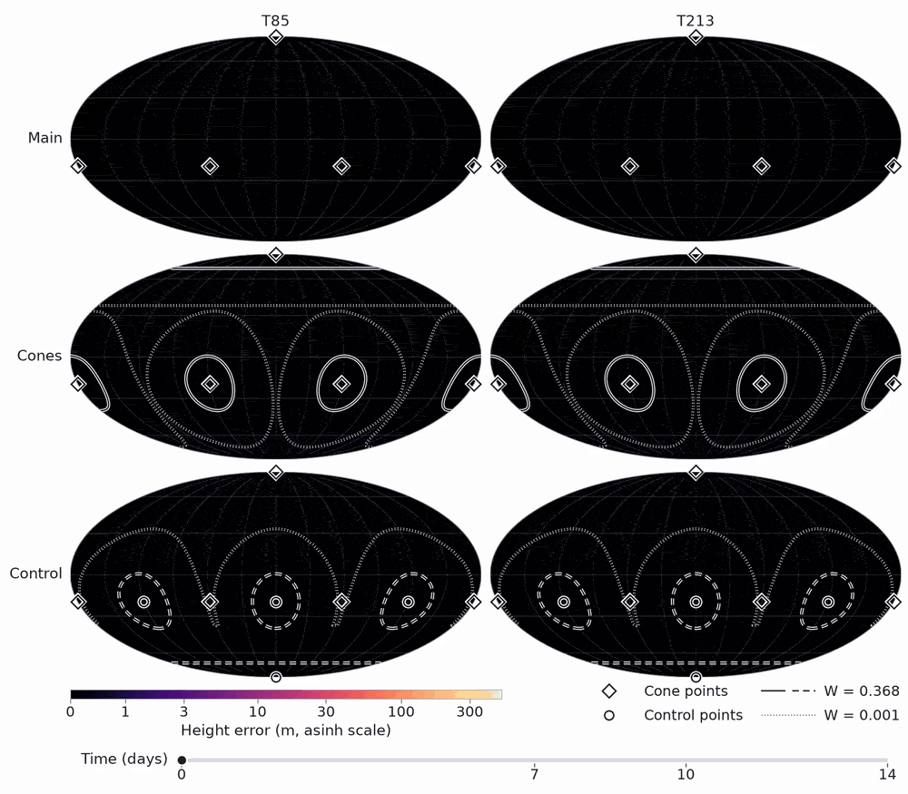
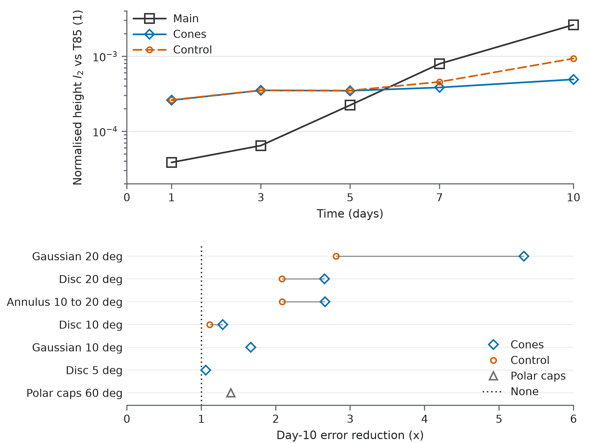
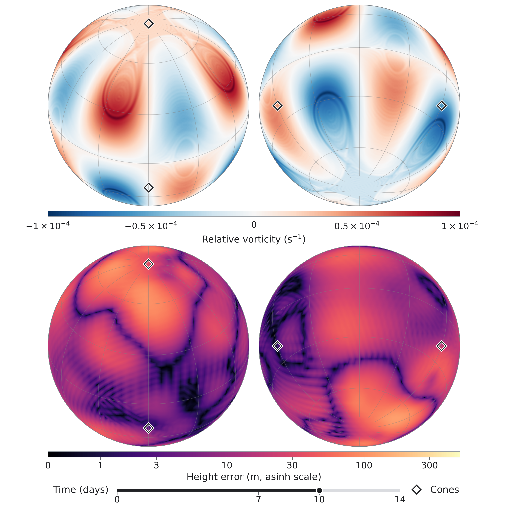
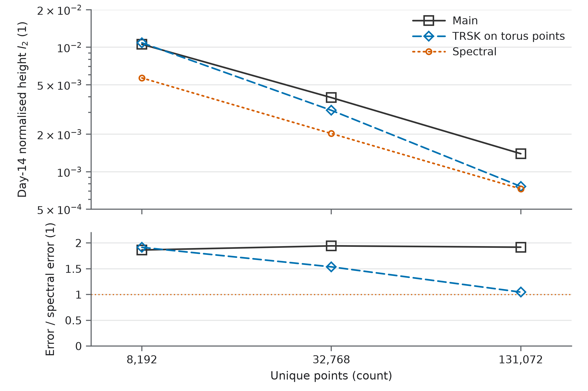

# sphere-grid-errors

The shallow-water equations model a thin fluid layer on a rotating sphere, capturing weather-like atmospheric flow on large scales. Williamson test case 6, the standard Rossby-Haurwitz wave, sends four highs and lows round the globe; here it breaks into filaments finer than the grid in the second week. The [solver](https://github.com/philippbogdan/sphere-on-a-torus) wraps a regular square grid on a doughnut-shaped torus twice round the sphere so every point uses the same local pattern of neighbours. Roughly evenly spaced sphere grids with fixed local reach need special points: 8 corners on a cubed sphere, 12 pentagons on an icosahedral grid, or 4 cones here. In this run, nudging the flow by pulling it towards a reference near these cones cuts day-10 height error 3.9x against the independent T213 reference, versus 2.5x near four other points; against the T85 target, the reductions are 5.3x versus 2.8x.

Height error over days 0 to 14: no nudge (top), nudging near the cones (middle) and the same nudge around four other points (bottom), with each nudge covering about 12% of the sphere. The early penalty turns into a benefit as the flow develops filaments finer than the grid.

## Where correction pays off

The error spreads broadly: the cone points seed it, rather than mark where it is largest. TRSK, a different scheme on the same points, closed the gap to the spectral model as resolution increased; the main scheme still has 1.9x its day-14 error. This points to the treatment of flow finer than the grid near those points as the route to improvement, without removing the points or requiring full rotational symmetry.

The left column scores against the correction target, T85. Against the independent T213 reference on the right, the reductions remain **3.94x versus 2.52x** at day 10, and **4.38x versus 2.11x** at day 14. [Scores and provenance](data/visual-runs.json).

All 12 archived configurations are shown, including the early cost of correction. [Load the values](data/relaxation.csv).

## Where the error sits

The reference flow develops fine structure above; the main scheme's height error against T213 spreads across broad patches below. Click for days 0 to 14.

The error is not visibly concentrated at the cones: they are where correcting it pays off most, not where it is largest. [Regional measurements](docs/FIELDS.md#regional-scores) confirm this. [Restart and twin checks](docs/METHOD.md#restart-and-twin-checks) support fresh error generation as the flow becomes finer, with limited growth of the three tested perturbations.

## The same points, a different numerical method

TRSK on the same torus points closed the gap as resolution increased, finishing 4.58% above spectral. The main scheme still has about **1.9x** the spectral model's day-14 error.

The cones remain; their numerical treatment changes. [Methods and limits](docs/METHOD.md#resolution-and-discretisation); [the solver's wider results](https://github.com/philippbogdan/sphere-on-a-torus).

## Assumptions made

- The flow is modelled by the classical shallow-water equations in Williamson test case 6.
- The relaxation runs use M = 128 and an external T85 solution; the 5.3x reduction is scored against that target. [Setup](docs/METHOD.md#relaxation).
- Height errors use area weighting and interpolated numerical references. [Error definition](docs/METHOD.md#test-grid-and-error) and [reference limits](docs/METHOD.md#reference-sensitivity-and-scope).

## How to use it

- **Load:** [CSV tables, JSON claims and original records](data/README.md), with [figure formats and sources](figures/README.md).
- **Run:** [check the numbers or regenerate the experiments and visuals](REPRODUCE.md). Large fields are regenerated locally and are not hosted.
- **Port:** apply the [correction and control experiment](docs/METHOD.md#relaxation) to another solver, retaining an independent scoring reference and the early-time comparison.
- **Free to use:** our code, figures and derived results are [CC0](LICENSE). [Third-party software retains its own terms](THIRD_PARTY.md).
