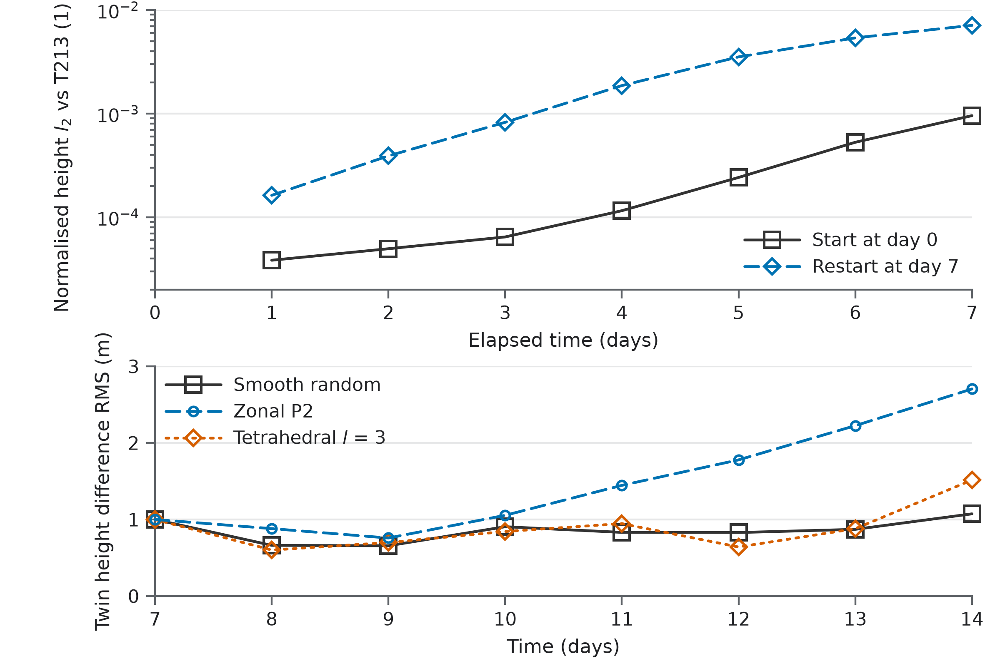

# Diagnosing late error

Correcting the four cone regions gives 5.3x lower day-10 height error in this test, compared with 2.8x for comparable regions away from the cones. This identifies a useful place to investigate a sphere solver whose error grows as the flow develops finer structure. The complete archived evidence and arithmetic are in [relaxation.csv](../data/relaxation.csv) and [claims.json](../data/claims.json).

## Test, grid and error

The experiment solves the classical shallow-water equations on a sphere using Williamson test case 6, a wavenumber-four Rossby-Haurwitz wave. The evolving numerical reference develops fine structures during the second week. The initial wave supplies an exact initial condition; it is not treated as an exact evolving shallow-water solution.

The main solver maps an M by M periodic torus lattice onto the sphere. Each physical location is computed twice, giving M squared computed sites and M squared / 2 unique points. The four branch points, called cones here, lie at the north pole and at latitude -19.4712206 degrees with longitudes 0, 120 and -120 degrees. The cone angle in the cover is 4 pi. Cells beside a cone have roughly 2:1 stretching.

The main scheme uses eighth-order centred differences, a ten-stage fourth-order time integrator and special adjoint gradient/divergence operators within eight cells of each cone. Its full-step stencil reaches 42 lattice points. The exact configuration is retained in every selected record. See the pinned solver's [method](https://github.com/philippbogdan/sphere-on-a-torus/blob/376f20bda091acee109abd183bc4684080288fc9/docs/METHOD.md) for the map, cone treatment and dissipation.

For height h, interpolated reference height h_ref and numerical area weights w, the dimensionless normalised error is

```text
l2 = sqrt(sum(w * (h - h_ref)^2) / sum(w * h_ref^2))
```

All computed sites contribute, including both copies of the cover. This is a relative height norm, not metres, a pointwise maximum or an error in height anomaly. RMS errors in metres use the same weighted squared differences divided by the sum of weights. The reference is interpolated to the solver's points before scoring. Its interpolation and numerical error remain part of the comparison.

## Relaxation

After each numerical step of length dt, selected height and velocity values are moved towards the externally supplied T85 state:

```text
q_new = q_step + (dt / 3600 s) * W * (q_target - q_step)
```

Here q denotes height above topography or a velocity component. The target is interpolated in space and linearly between two-hourly reference samples. The update is applied only where W > 0.001. This is a diagnostic intervention using an external solution, not an improvement delivered by the unmodified solver.

Let d be the angular distance in degrees to the nearest of four centres. The weights are:

```text
Gaussian R:       W = exp(-(d/R)^2)
Disc R:           W = 0.5 * (1 - tanh((d-R)/2))
Annulus R to 2R:   W = 0.25 * (1 + tanh((d-R)/2)) * (1 - tanh((d-2R)/2))
Polar caps L:     W = 0.5 * (1 + tanh((abs(latitude)-L)/3))
```

The Gaussian uses the nearest centre, not a sum of four Gaussians. The discs and annuli have smooth edges. Weighted area is `sum(w*W)/sum(w)`, including the small inactive tail; it is not the area enclosed by a contour. The Gaussian 20 degree cases cover 11.9377% and 11.8173% by this definition, so their areas are comparable rather than identical.

The controls replace the north-pole centre with the south pole and rotate the three southern centres by 60 degrees in longitude. They preserve absolute latitude. They are not a single rigid rotation of the cone tetrahedron. The record field `control_rotation_deg` identifies this construction, not the full geometry. Gaussian tails can reach cone locations even when their centres are elsewhere.

| Index | Record region | Scale, degrees | Centres |
|---:|---|---:|---|
| 0 | none | 0 | No correction |
| 1 | bp | 10 | Cones |
| 2 | bp | 20 | Cones |
| 3 | disc | 5 | Cones |
| 4 | disc | 10 | Cones |
| 5 | disc | 20 | Cones |
| 6 | annulus | 10 | Cones |
| 7 | polar | 60 | Both polar caps |
| 8 | bp | 20 | Controls |
| 9 | disc | 20 | Controls |
| 10 | annulus | 10 | Controls |
| 11 | disc | 10 | Controls |

Each archived configuration is one deterministic run at M = 128. All four paired shapes favour cone correction at day 10. The unpaired polar treatment reduces the error by 1.40x; its area and geometry differ, so it is not a paired cone comparison. The two smaller cone treatments also remain in the table and chart.

Correction has an early cost: the principal cone and control runs have higher error than the unrelaxed run at days 1, 3 and 5. The target and scoring reference are the same T85 solution, with a 45 s step. Its own day-14 error against T213 is `1.316692311303758e-3`. The larger `2.026903366987291e-3` belongs to T85 at 450 s, used in the resolution comparison. These two configurations must not be interchanged.

## Extension through day 14

The three visual runs reproduce the archived day-10 scores to relative differences of order 1e-9, then continue to day 14. Their separate [run summary](../data/visual-runs.json) preserves full-precision T85 scores and identifies the T213 scores reconstructed from the saved fields.

| Run | Day-14 l2 against T85dt45 | Reduction from unrelaxed |
|---|---:|---:|
| Main | 9.575178947e-3 | 1 |
| Cone correction | 1.387106241e-3 | 6.90x |
| Control correction | 4.117020365e-3 | 2.33x |

These are one new run per configuration at M = 128, not extra replicates of all 12 archived treatments. Scoring against the independent T213 reference preserves the cone advantage at a smaller size:

| Day | Main l2 | Cone l2 | Control l2 | Main / cones | Main / control |
|---:|---:|---:|---:|---:|---:|
| 10 | 2.869579195e-3 | 7.278583003e-4 | 1.139957130e-3 | 3.94x | 2.52x |
| 14 | 1.056205707e-2 | 2.411040108e-3 | 5.003838911e-3 | 4.38x | 2.11x |

T213 was not the relaxation target. These scores come from the saved float32 fields, with more digits retained in [field-metrics.csv](../data/field-metrics.csv) than needed for the displayed ratios. The new main-run scores agree with the archived daily T213 scores in `tc6_series.jsonl` to within 6e-6 relative at the recorded days 1, 3, 5, 7, 10 and 14. At day 14 the values are `1.056205707e-2` and `1.0562056724e-2`; the separate endpoint record in `accuracy_main_ref.jsonl` is `1.0562054569e-2`.

The error is not visibly concentrated at the cones: the cones are where correcting it pays off most, not where it is largest. For the unrelaxed run against T213, cone-weighted squared-error enrichment is 0.78, 0.67, 1.10 and 1.37 at days 3, 7, 10 and 14; the controls give 1.04, 0.83, 1.15 and 1.34. A value of one means the error share equals the weighted area share. [FIELDS.md](FIELDS.md#regional-scores) defines this measure and its overlapping Gaussian weights.

## Restart and twin checks



The restart produces 12.8x more error after three elapsed days than the day-0 start. Three 1 m perturbations end at 1.07, 2.70 and 1.52 m RMS, respectively.

The restart initialises the main solver from the reference's day-7 height and wind. The comparison is day 7 to day 10 against day 0 to day 3, each scored against the reference at its own endpoint. It compares equal elapsed intervals in different flow states, not two errors at the same calendar day. After three days, the M = 128 restart has about 17.3 m RMS error in the northern 60 to 90 degree band and 16.4 m in the southern band, versus about 3.0 to 3.7 m near the equator. [restart.csv](../data/restart.csv) also retains the other resolutions, schemes and available latitude-band measurements.

The twins start from the day-7 reference state. One member receives a height perturbation normalised to 1 m RMS: smooth random, zonal P2 or tetrahedral degree three. The measured quantity is the weighted RMS height difference between the two numerical runs, not their common error against a reference. The day-7 value in [twins.csv](../data/twins.csv) is the initial condition, not a later observation.

Together, these checks support fresh numerical error generation during the evolving fine-scale flow, with limited amplification of the three tested perturbations. They do not bound every possible instability or prove that every late error originates at a mathematical point. Correction can also change downstream error, so a map of large error is not a map of its sources.

The archived high-latitude sharpness diagnostic gives length scales of about 1,633 km initially, 179 km at day 7 and 164 km at day 10. It uses `max(abs(zeta))/max(abs(grad(zeta)))` within absolute latitudes 60 to 80 degrees, excluding points within 6 degrees of a cone. It is neither a global spectral wavelength nor a measurement from the movie. The characteristic M = 128 area spacing is about 250 km.

## Resolution and discretisation

At 8,192, 32,768 and 131,072 unique points, the main scheme retains 1.86x, 1.94x and 1.92x the spectral model's day-14 error. TRSK on the same torus points has ratios 1.91x, 1.54x and 1.046x. It closed the gap as resolution increased; its finest error remains 4.58% higher. See [resolution.csv](../data/resolution.csv).

TRSK is an energy-conserving C-grid discretisation, implemented in the public solver with RK4 at Courant number 0.5. It uses the Voronoi mesh of the same unique torus points, including the same four cone locations. It computes height on cells and velocity on edges; the main scheme computes both copies of its cover. Equal unique-point counts therefore do not imply equal work, storage or degrees of freedom. The spectral comparators use T42, T85 and T170 with steps of 900, 450 and 225 s.

The change of discretisation closes much of the gap while retaining the point set. Full rotational invariance is therefore not required for the observed narrowing. The experiment does not isolate conservation, staggering, dissipation or any other single change as its cause, and does not establish a universal preference for TRSK. The public solver's other tests give different rankings.

The [context table](../data/context.csv) keeps the earlier time samples and a second comparison against icosahedral TRSK. At sampled days 1, 3 and 5, the main scheme has about 4.1x to 46x lower error in that second comparison. Its 10,368, 41,472 and 165,888 unique points exceed the corresponding 10,242, 40,962 and 163,842 TRSK cells by about 1.2%, and it computes two copies. This is not an equal-work result. Early spectral errors also depend on timestep: at day 5 the 90 s T42 and T85 runs give about `2.24e-4` and `6.27e-5`, respectively.

The source files retain dissipation sensitivity. At M = 128, changing the main filter gives day-14 errors of roughly `9.12e-3` to `1.18e-2` among the cited variants, around the main value `1.06e-2`. T85 at 45 s gives `1.32e-3` with the standard diffusion, `2.24e-3` with one tenth and `2.68e-3` with one hundredth. These checks qualify the comparison; they do not identify a single fix.

## Reference sensitivity and scope

T213 with a 22.5 s step is the principal numerical reference, not an exact solution. The recorded day-14 T213 versus T341 difference at 90 s is `2.801296779272977e-4`. The T213 45 s versus 22.5 s difference is `2.8401058941273965e-5`. These are separate empirical sensitivity checks, not confidence intervals to place around each plotted point. Being within 5% of a comparator does not establish equality to the exact solution.

For this locally oriented torus-to-sphere cover, the Riemann-Hurwitz relation requires total branching twice the cover degree. Degree two gives four simple branch points. This construction-specific statement does not establish a numerical error floor for every folded or seamed sphere grid. A fixed grid has at most a finite rotation group; no measured equivariance defect is supplied here.

The evidence covers one classical shallow-water test and the stated configurations. It supplies no learned model, operational forecast result or hardware comparison. There are no replicate means or confidence intervals. The intervention, restart and twin evidence supports a targeted numerical diagnosis, not a universal causal theorem about non-equivariant grids.

## Methods sources

- Williamson et al. (1992), *A standard test set for numerical approximations to the shallow water equations in spherical geometry*, supplies TC6 and the normalised error convention. The implemented initial condition is in the pinned solver's [testcases.py](https://github.com/philippbogdan/sphere-on-a-torus/blob/376f20bda091acee109abd183bc4684080288fc9/polarswe/testcases.py).
- Hack and Jakob (1992), NCAR Technical Note TN-343+STR, describes the spectral shallow-water model. The [Netlib distribution](https://www.netlib.org/chammp/) contains STSWM 2.0, its documentation and terms.
- Thuburn et al. (2009), *Journal of Computational Physics* 228, 8321 to 8335, and Ringler et al. (2010), *Journal of Computational Physics* 229, 3065 to 3090, supply the TRSK formulation. The implementation used here is [trsk.py](https://github.com/philippbogdan/sphere-on-a-torus/blob/376f20bda091acee109abd183bc4684080288fc9/polarswe/trsk.py).
- The pinned [experiment script](https://github.com/philippbogdan/sphere-on-a-torus/blob/376f20bda091acee109abd183bc4684080288fc9/scripts/tc6_week2.py) specifies the intervention, restart, twin and sharpness calculations. [FIELDS.md](FIELDS.md) defines the display transformations and additional field metrics.
